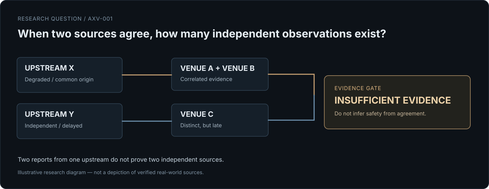
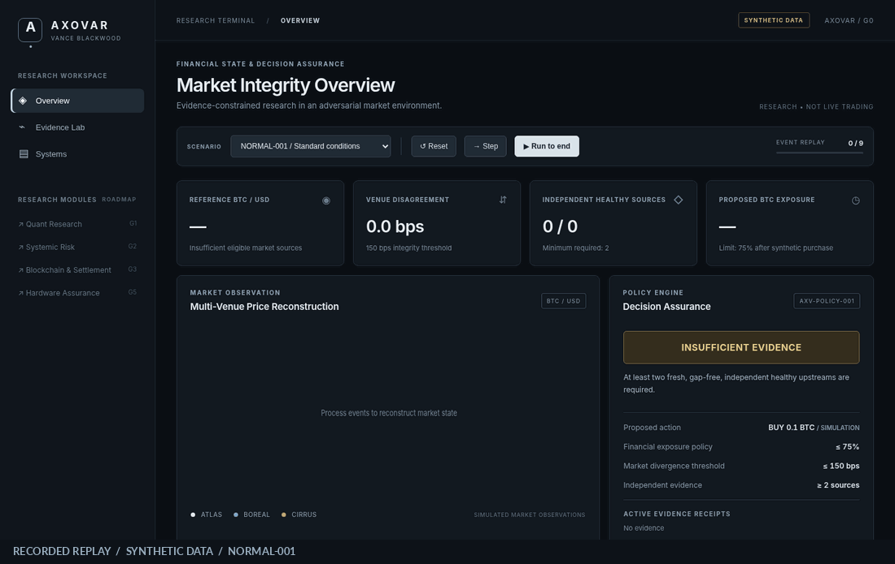
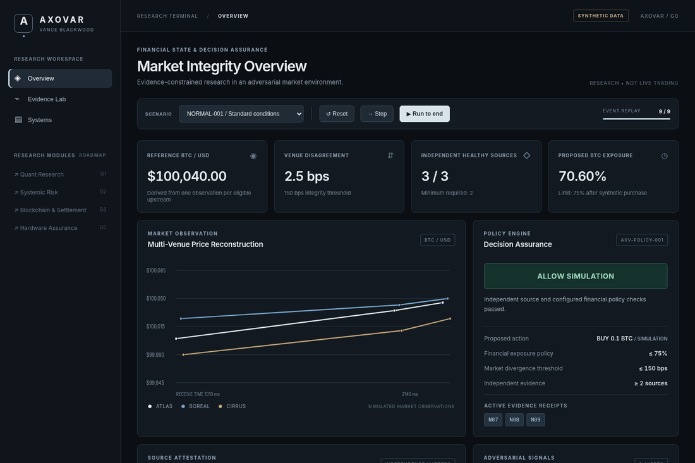
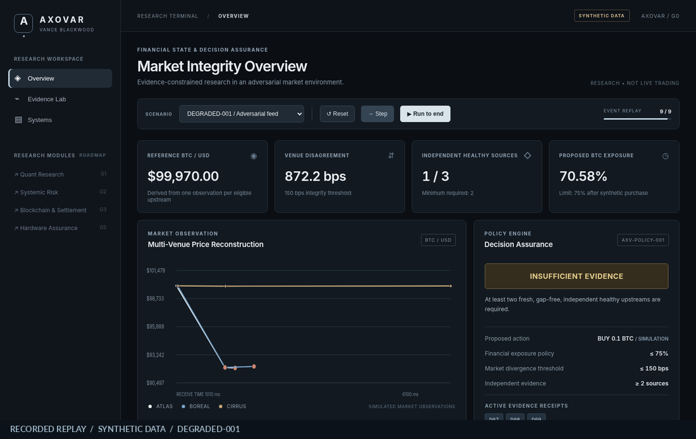
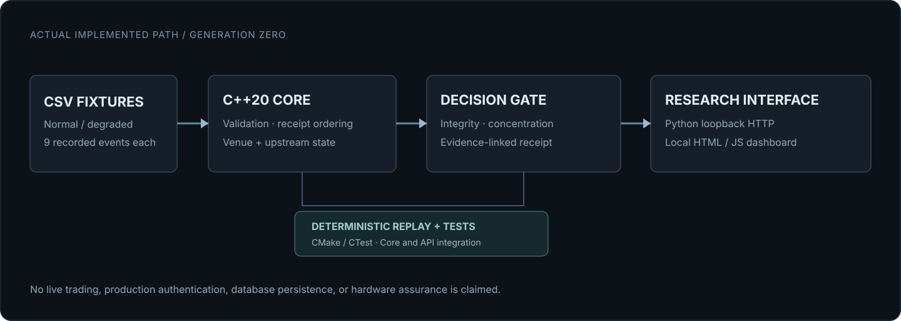

<div align="center">


# AXOVAR

**ADVERSARIAL FINANCIAL INTELLIGENCE & VERIFIABLE SYSTEMS INFRASTRUCTURE**

*An evidence-constrained research system for financial decisions under unreliable market observations.*

[](https://github.com/julianvanceblackwood/AXOVAR/actions/workflows/verify.yml)


[**Research Thesis**](#research-thesis) · [**Recorded Demonstration**](#recorded-demonstration) · [**Architecture**](#generation-zero-architecture) · [**Intelligence**](#axovar-intelligence) · [**Run Locally**](#run-locally) · [**Roadmap**](#research-direction)

</div>

---

## The problem

**What happens to a financial decision when the information supporting it can no longer be trusted?**

A price is not a market state. Two matching feeds are not necessarily two independent observations. A content hash does not prove the truth of a source. And a valid quantitative signal is not, by itself, authorization to act.

Financial decision systems must contend with conflicting venues, incomplete event sequences, delayed observations, correlated upstream dependencies, uncertain source health and constraints on portfolio exposure. Under these conditions, choosing a plausible number is not the same as establishing a defensible conclusion.



> **AXOVAR's central principle:** a financial decision must not inherit more certainty than its supporting evidence permits.

## Recorded demonstration



<sub>Actual AXOVAR G0 dashboard rendering successive outputs from the compiled C++ research engine. This is a recorded replay of synthetic fixtures, **not** a live market feed or production trading terminal.</sub>

The same candidate action is evaluated under two deliberately different information conditions:

| Scenario | Evidence conditions | Final simulated decision |
| :--- | :--- | :--- |
| `NORMAL-001` | Three eligible, healthy, independently labelled upstreams; limited price disagreement | `ALLOW_SIMULATION` |
| `DEGRADED-001` | Shared upstream dependency, degraded feeds, sequence gap and delayed observations | `INSUFFICIENT_EVIDENCE` |

The change in outcome is not a trading strategy. It demonstrates that evidence sufficiency and financial constraints can be evaluated separately from the attractiveness of a hypothetical action.

<details>
<summary><strong>Static dashboard views</strong></summary>

**Normal market**



**Degraded market**



</details>

## Research thesis

AXOVAR investigates **evidence-constrained market state reconstruction and decision assurance**: how to preserve the relationship between observations, derived financial state, assumptions and policy outcomes when sources are imperfect.

Three distinctions govern the architecture:

| Observation | What it establishes | What it does not establish |
| :--- | :--- | :--- |
| Multiple matching prices | Reported agreement among observations | Independence or economic truth |
| SHA-256 fixture digest | Byte identity of the recorded fixture | Source authenticity or completeness |
| Passing risk policy | The declared checks passed on eligible inputs | A safe or profitable real-world trade |

**Unknown is a legitimate result.** If required observations are stale, incomplete or not independent, the engine may refuse to justify a simulated decision rather than silently substitute certainty.

## What is implemented

Generation Zero is an **executable research vertical slice**, not a completed institutional risk platform.

| System | Verified G0 scope |
| :--- | :--- |
| **C++20 event core** | Strict synthetic CSV parsing, typed integer inputs and receipt-time ordering |
| **Market reconstruction** | Latest per-venue observations and a baseline reference-price estimate |
| **Source integrity** | Sequence-gap detection, staleness, explicit health labels and upstream deduplication |
| **Quantitative policy** | Simulated 0.1 BTC purchase, 75% concentration ceiling and 150 bps divergence rule |
| **Decision engine** | `ALLOW_SIMULATION`, `DENY_SIMULATION`, `INSUFFICIENT_EVIDENCE` |
| **Evidence view** | Event IDs, original fixture bytes and API-computed SHA-256 fingerprints |
| **Local research API** | Python standard-library HTTP service bound to `127.0.0.1` |
| **Research dashboard** | Replay controls, market chart, venue health, integrity alerts and decision inspection |
| **AXOVAR Intelligence** | Read-only evidence explanations, grounded scenario context and optional local Gemma 3 model Q&A |
| **Verification** | Automated engine, API and Intelligence tests through CTest and GitHub Actions |

The reference price is an **arithmetic mean of one eligible price per declared upstream**. This is a controlled baseline, not a production-grade market price oracle. The upstream identity and health fields come from fixtures and are **not** independently authenticated.

## Generation Zero architecture



The executable path is intentionally compact. A C++20 core processes synthetic scenarios and emits derived JSON state. A loopback Python adapter exposes that state to the local dashboard. Tests exercise the core and API behavior.

**The principal trust boundary:** source assertions and fixture-defined independence must never be mistaken for independently established economic truth. See [architecture and limitations](docs/ARCHITECTURE.md).

## AXOVAR Intelligence

**Research assistant for market evidence and technical questions.** The dashboard now includes an Intelligence workspace. It uses two deliberately separate components.

- **Evidence-only mode** runs without downloads or external APIs. It explains the current synthetic scenario, policy decision, venue health, source independence assumptions and the limits of observed evidence using deterministic Python code. This is not a trained AI model.
- **Local model mode** connects to an independently installed [Ollama](https://ollama.com/) server at `127.0.0.1:11434` and uses the open-weight `gemma3:4b` model for broader natural-language answers and explanations. This is an integrated third-party model, not a model trained by Vance Blackwood. The model is optional and is not included in this repository.

To enable local model answers on your Mac, install Ollama using its official instructions, then run:

```bash
ollama pull gemma3:4b
ollama serve   # only if the Ollama app or daemon is not already running
./run.sh       # run separately from the AXOVAR project directory
```

Open `http://127.0.0.1:8765`, enter **Intelligence**, select the synthetic scenario and choose a question. If Ollama is unavailable, AXOVAR falls back to evidence-only explanations. It does not automatically download model weights or send scenario data to an internet-based model API.

**Security and epistemic boundary:** a fixed local model endpoint, bounded question size, curated derived snapshot, no raw fixture transfer, no model tools, no shell access, no autonomous orders and no authority to change C++ risk-policy decisions. Model prose is unverified analysis. References to event IDs identify the underlying engine receipts but do not prove the model's interpretation. Prompt injection and hallucinations remain possible; the deterministic gate is authoritative. See [Intelligence design](docs/INTELLIGENCE.md).

This release adds **research question answering**, not trained proprietary AI, learned market prediction, true causal inference, calibrated confidence or production-grade retrieval. Questions about external or current market conditions are not supported by the synthetic data. Some general technical questions require the optional local model.

## Run locally

**Requirements:** macOS or Linux, CMake 3.20+, C++20 compiler and Python 3.10+. No exchange keys, package installation, account connection or internet access are required for the application.

```bash
# Clone the independent research repository
git clone https://github.com/julianvanceblackwood/AXOVAR.git
cd AXOVAR

# Build, verify and launch the loopback dashboard
chmod +x run.sh
./run.sh
```

Open **http://127.0.0.1:8765** in your browser.

For separate verification:

```bash
cmake -S . -B build -DCMAKE_BUILD_TYPE=Release
cmake --build build --parallel
ctest --test-dir build --output-on-failure

./build/axovar_core --scenario scenarios/NORMAL-001.csv 9
./build/axovar_core --scenario scenarios/DEGRADED-001.csv 9
```

The last argument is the number of received events available at that replay step. Neither event time nor a later observation is allowed to grant knowledge retroactively.

### Local API

| Method | Route | Purpose |
| :--- | :--- | :--- |
| GET | `/api/health` | Local service status |
| GET | `/api/scenarios` | Available fixtures |
| GET | `/api/state` | Current engine state and decision |
| GET | `/api/raw` | Recorded fixture lines and hashes |
| GET | `/api/intelligence/status` | Local model availability and suggested research questions |
| POST | `/api/intelligence/ask` | Read-only question with current derived replay state |
| POST | `/api/replay/scenario` | Select an allowlisted scenario |
| POST | `/api/replay/step` | Advance one received event |
| POST | `/api/replay/reset` | Restart current scenario |
| POST | `/api/replay/end` | Replay all received events |

**Security boundary:** the service is for local research use only. It is loopback-bound, process-local and has no production multi-user authentication. Do not expose it to an untrusted network or connect real trading accounts.

## Research direction

The current implementation proves a limited end-to-end behavior. Future research is organized into independent engineering gates, each requiring tests or measurement before its status advances.

| Gate | Research boundary | State |
| :--- | :--- | :--- |
| **G0** | Deterministic market fixtures → integrity and concentration policy → explainable simulation receipt | **Implemented / tested** |
| **G1** | Source-dependency semantics, robust market-state reconstruction and improved numeric assurance | Planned |
| **G2** | Quantitative research, backtesting methodology, portfolio and systemic risk | Planned |
| **G3** | Blockchain settlement uncertainty and cyber-financial incident reconstruction | Planned |
| **G4** | Machine-checkable decision constraints and stronger replay evidence | Planned |
| **G5** | Low-latency profiling and independently verified FPGA-oriented experiments | Planned |

The broader program concerns market microstructure, correlated data failures, quantitative model validity, cross-ledger settlement, systemic contagion, defensive cybersecurity and hardware/software assurance. **These are research directions, not existing G0 features.** Full sequence: [ROADMAP](docs/ROADMAP.md).

## Research portfolio alignment

AXOVAR develops alongside three independent research projects:

| Project | Relationship | Integration status |
| :--- | :--- | :--- |
| [KORDAXIS](https://github.com/julianvanceblackwood/KORDAXIS) | Evidence-native defensive reasoning, provenance and uncertainty | Conceptual alignment |
| [ELENCHION](https://github.com/julianvanceblackwood/ELENCHION) | Evidence-bounded execution intelligence and observability limits | Research alignment |
| [TEICHION](https://github.com/julianvanceblackwood/TEICHION) | Hardware-owned event sequencing and canonical record research | Future interface study |

No integration or production-grade hardware security is claimed by this README.

## Assurance boundaries

AXOVAR G0 **does not** implement live trading, production exchange connectivity, authenticated external feeds, real blockchain settlement, a persistent evidence database, calibrated uncertainty sets, formal verification proofs, mature portfolio accounting, a proprietary trained language model or an FPGA accelerator.

The toy valuation currently uses integer price inputs and `long double`-based derived exposure calculations. It is **not** a production ledger precision model. The decision receipt is not digitally signed. The simulated market evidence may be wrong even when its file hash is correct.

Financial decisions remain research-only. **No real orders are submitted.**

## Engineering and governance references

- [CPMI-IOSCO Principles for Financial Market Infrastructures](https://www.bis.org/committees/cpmi/pfmi/overview)
- [Monetary Authority of Singapore](https://www.mas.gov.sg/) — financial technology and operational resilience reference material
- [NIST AI Risk Management Framework](https://airc.nist.gov/) — relevant future model governance research

These references are research context, not institutional affiliation, regulatory approval or compliance claims.

---

<div align="center">

**VANCE BLACKWOOD / RESEARCH SYSTEMS**

*Build decisions that can withstand the failure of their own evidence.*

</div>
