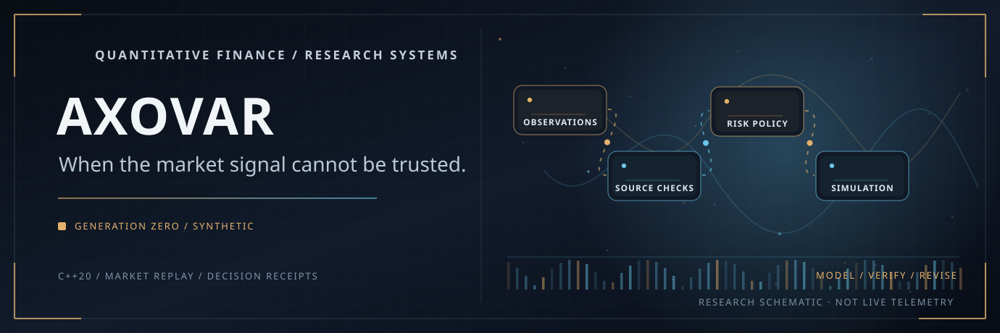

# AXOVAR

**VANCE BLACKWOOD CAPITAL / RESEARCH SYSTEMS**

*Build decisions that can withstand the failure of their own evidence.*

[](https://github.com/julianvanceblackwood/AXOVAR/actions/workflows/verify.yml)



AXOVAR is a local research system for reconstructing financial decisions from incomplete or unreliable evidence. The C++20 engine replays synthetic market observations, evaluates source integrity and risk constraints, and produces an auditable decision record. Separate modules examine portfolio accounting, settlement uncertainty and performance.

The software uses synthetic fixtures. It does not connect to exchanges, hold funds, place orders or establish production-grade market or settlement finality.

## Run

Requirements: macOS or Linux, CMake 3.20 or later, a C++20 compiler and Python 3.10 or later.

```bash
git clone https://github.com/julianvanceblackwood/AXOVAR.git
cd AXOVAR
./run.sh
```

The script builds the core, runs the tests and starts the dashboard at [http://127.0.0.1:8765](http://127.0.0.1:8765). No financial credentials are required.

To run the engine without the dashboard:

```bash
cmake -S . -B build -DCMAKE_BUILD_TYPE=Release
cmake --build build --parallel
ctest --test-dir build --output-on-failure

./build/axovar_core --scenario scenarios/NORMAL-001.csv 9
./build/axovar_core --scenario scenarios/DEGRADED-001.csv 9
```

The normal fixture produces `ALLOW_SIMULATION`. The degraded fixture produces `INSUFFICIENT_EVIDENCE`. These are policy outputs for constructed inputs, not investment signals.

<details>
<summary>Recorded local demonstration</summary>


The recording shows the local application processing prepared fixtures. It is not live market telemetry.

</details>

## System components

| Component | Implemented scope |
| --- | --- |
| Market replay | Receipt-time ordering, sequence-gap detection, source staleness and upstream dependency checks |
| Decision policy | At least two eligible upstreams, a 150 bps disagreement threshold and a 75% synthetic BTC exposure limit |
| Audit receipts | Versioned `AXV-AUDIT-002` record, evidence references and canonical SHA-256 digest |
| Independent verification | Exact-rational reference checks, bounded state enumeration and local evidence-journal validation |
| Portfolio risk | USD-cent accounting, FIFO cost basis, reconciled P&L, synthetic stress scenarios and descriptive VaR / expected shortfall |
| Settlement research | Synthetic transaction inclusion, chain reorganization, confirmation reversal and counterparty holds |
| Performance | Separate C++ ingest/replay timings, bounded HTTP load measurements and compiler/sanitizer checks |

The market engine has three outcomes: `ALLOW_SIMULATION`, `DENY_SIMULATION` and `INSUFFICIENT_EVIDENCE`. An allow result means only that the declared checks passed on the supplied evidence.

A venue that changes its declared upstream is excluded for the rest of that replay. Matching observations from a shared upstream count as one source. These checks are deterministic but cannot authenticate fixture authors or prove that quoted prices are true.

The portfolio and settlement modules are independent experiments. They do not share a live account, market feed or settlement ledger.

## Evidence and verification

The audit endpoint returns the replay step, selected sources, policy checks and a receipt digest. The standalone verifier recomputes the decision from the fixture and checks the receipt without importing the engine or receipt generator.

```bash
# In another terminal, with the normal scenario selected in the dashboard
curl --fail --silent http://127.0.0.1:8765/api/audit/receipt > receipt.json
python3 -m verification.decision_reference \
  --receipt receipt.json \
  --fixture scenarios/NORMAL-001.csv
```

An optional local journal can retain fixtures and audit responses in hash-linked records:

```bash
python3 -m verification.evidence_journal append \
  --journal local-evidence.jsonl \
  --receipt receipt.json \
  --fixture scenarios/NORMAL-001.csv
python3 -m verification.evidence_journal verify \
  --journal local-evidence.jsonl
```

The journal is not digitally signed or independently anchored. Anyone controlling the host could replace it and recalculate its hashes.

The automated verification workflow covers GCC and Clang builds, the bounded policy model, audit and API regressions, synthetic portfolio and settlement cases, compiler-output comparison, and Clang UndefinedBehaviorSanitizer. Tests establish their stated input and environment boundaries rather than full formal correctness.

## Performance measurements

G5 separates the cost of C++ fixture ingestion and policy replay from the cost of local HTTP requests. Reports include synthetic workload information, repeat counts, latency percentiles and machine metadata.

```bash
python3 benchmarks/run.py \
  --binary build/axovar_bench \
  --samples 200 --warmups 20 \
  --output reports/core-performance.json

python3 benchmarks/service_load.py \
  --binary build/axovar_core \
  --concurrency 4 --requests-per-route 15 \
  --output reports/service-load.json
```

GitHub Actions also retains the JSON measurement reports as short-lived workflow artifacts. Values from shared CI runners are not service-level guarantees or evidence of a production speedup. See [G5 measurement methodology](docs/G5_PERFORMANCE.md).

## Local API

The service listens on `127.0.0.1` and is intended for one local research session.

| Method | Endpoint | Purpose |
| --- | --- | --- |
| GET | `/api/health`, `/api/scenarios` | Service status and prepared scenarios |
| GET | `/api/state`, `/api/raw` | Replay state and underlying fixture evidence |
| GET | `/api/audit/receipt` | Versioned decision receipt |
| GET | `/api/risk/portfolio` | Independent synthetic portfolio analysis |
| GET | `/api/settlement` | Synthetic chain and counterparty timeline |
| POST | `/api/replay/scenario`, `/api/replay/step`, `/api/replay/reset`, `/api/replay/end` | Local replay controls |

The dashboard also has a read-only Intelligence workspace. Evidence explanations run locally without a model. Optional natural-language questions use a separately installed Ollama/Gemma 3 model. Model responses cannot approve decisions or alter policy. See [Intelligence design](docs/INTELLIGENCE.md).

This API has no institutional identity, authorization or multi-tenant controls. Do not expose it to untrusted networks or connect customer financial accounts.

## Technical documentation

| Document | Scope |
| --- | --- |
| [Start here](docs/START_HERE.md) | Local evaluation and expected outcomes |
| [Architecture](docs/ARCHITECTURE.md) | Components and trust boundaries |
| [Decision audit](docs/DECISION_AUDIT.md) | Receipt format and source-selection semantics |
| [Independent verification](docs/G4_VERIFICATION.md) | Policy reference, finite-state tests and limits |
| [Portfolio risk](docs/PORTFOLIO_RISK.md) | Accounting identities and stress methodology |
| [Settlement research](docs/SETTLEMENT_RESEARCH.md) | Reorganizations, confirmation policy and incidents |
| [G5 performance](docs/G5_PERFORMANCE.md) | Measurement definitions and limitations |
| [Assurance status](docs/ASSURANCE_STATUS.md) | Current evidence and unresolved acceptance gates |
| [Roadmap](docs/ROADMAP.md) | Research stages and pending engineering work |

## Status and limitations

AXOVAR is a tested research implementation, not an investor-ready or production financial platform. Authorized market-data integration, independent evidence attestation, real settlement verification, production security, operational service levels and customer validation are still open. The current C++ policy also uses floating-point derived values; the independent verifier checks its fixed synthetic contract, not every possible real-world numerical condition.

The repository does not currently declare an open-source license. Public visibility alone does not grant reuse or redistribution rights. Reproducible technical reports are welcome through [GitHub Issues](https://github.com/julianvanceblackwood/AXOVAR/issues).

---

**VANCE BLACKWOOD CAPITAL / RESEARCH SYSTEMS**

*Build decisions that can withstand the failure of their own evidence.*
